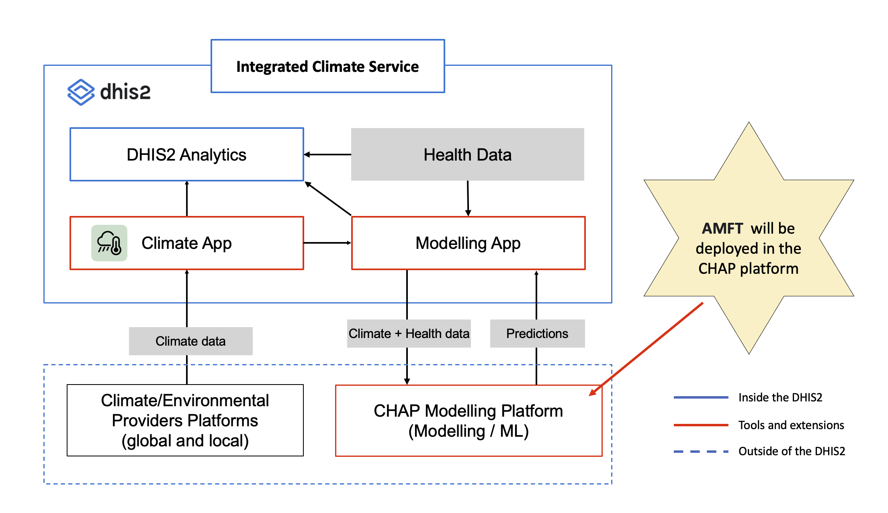

# Acute Malnutrition Forecasting Tool (AMFT)

AMFT is a Streamlit-based decision-support tool for district-level acute malnutrition monitoring in Uganda. It combines anomaly detection, short-term forecasting, geospatial visualization, data quality checks, and model evaluation to support early warning and operational planning.

The current version focuses on three connected outputs:

- 4-level anomaly classification for within-district and between-district monitoring
- 3-level operational alerts derived from anomaly combinations
- 3-month district forecasts of GAM caseloads with uncertainty bounds

## What Changed in the Current Tool

The README has been updated to reflect the current app behavior. The tool now uses:

- anomaly levels of `Low`, `Moderate`, `High`, and `Extreme`
- operational alerts of `Monitor`, `Alert`, and `Respond`
- 3-month recursive forecasting with `Lower_80` and `Upper_80` intervals
- district filtering across the full app
- observed and forecast map views for anomalies and operational alerts
- built-in data quality summaries for districts and months
- classification and regression model checks inside the app
- optional IPC AMN severity labeling when direct GAM prevalence columns are available

## Core Capabilities

- Load district monthly GAM caseload data from a local path or file upload
- Load district boundaries from a local GeoJSON path or file upload
- Classify observed GAM caseloads using district-relative and peer-relative anomaly rules
- Generate operational alerts from within-district and between-district anomaly combinations
- Forecast district GAM caseloads for the next 3 months
- Display forecast uncertainty with 80% intervals
- Compare districts or regions against a national reference trend
- Explore Spearman correlations between GAM caseload and covariates
- Review regression and classification model performance
- Download classified observed data and forecast outputs

## Risk Framework

### 1. Anomaly Classification

Observed and forecast anomaly labels use percentile thresholds:

| Level | Threshold | Meaning |
|---|---|---|
| `Low` | Below 75th percentile | Within the usual range |
| `Moderate` | 75th to below 90th percentile | Higher than usual |
| `High` | 90th to below 95th percentile | Unusually high |
| `Extreme` | 95th percentile and above | Exceptionally high |

### 2. Operational Alert

Operational alerts are derived from the combination of within-district and between-district anomaly levels:

| Operational Alert | Rule | Typical Action |
|---|---|---|
| `Monitor` | Within = `Low` and Between = `Low` or `Moderate` | Routine monitoring |
| `Alert` | Within = `Low` and Between = `High` or `Extreme`, or Within = `Moderate` and Between = `Low` or `Moderate` | Heightened surveillance |
| `Respond` | Within = `High` or `Extreme`, or Within = `Moderate` and Between = `High` or `Extreme` | Immediate response |

### 3. IPC AMN Severity

If the dataset includes direct GAM prevalence columns such as WHZ- or MUAC-based prevalence, the app can also compute observed IPC AMN severity phases:

- `Acceptable`
- `Alert`
- `Serious`
- `Critical`
- `Extremely Critical`

If prevalence data are not present, the app still supports anomaly-based early warning and GAM caseload forecasting.

## How the App Works

The application follows this workflow:

1. Load monthly district GAM data.
2. Parse dates and standardize district labels.
3. Calculate within-district anomalies from each district's own historical distribution.
4. Calculate between-district anomalies from peer district and seasonal patterns.
5. Engineer lagged, rolling, trend, seasonal, and district-relative features.
6. Train Random Forest models for regression and anomaly classification.
7. Generate 3-month recursive district forecasts.
8. Convert forecast outputs into anomaly labels and operational alerts.
9. Visualize current conditions, historical patterns, drivers, forecasts, and model checks.

## App Sections

The Streamlit app is organized into four main tabs:

### Exploratory Analysis

- Run summary
- Data quality and methodology
- Current situation summaries
- Top districts by current operational alert
- Observed anomaly and operational alert maps
- Raw classified data table

### Drivers & Context

- Spearman correlation portrait
- District or regional comparison against the national reference
- Historical anomaly trend
- Historical GAM trend

### Forecasts

- 3-month district forecast chart
- Hindcast view for prior out-of-sample predictions
- Forecast table with uncertainty bounds
- Forecast anomaly and operational alert maps

### Model Checks

- Regression metrics such as MAE, RMSE, mean error, and P90 absolute error
- Predicted vs actual plots
- Residual analysis
- Largest forecast error review
- Feature importance charts
- Classification metrics for within-district and between-district anomaly models

## System Architecture

The tool is designed for integration with DHIS2 and the Climate Health Analytics Platform (CHAP).



## Installation

### 1. Create and activate a virtual environment

Windows:

```bash
python -m venv venv
venv\Scripts\activate
```

macOS / Linux:

```bash
python3 -m venv venv
source venv/bin/activate
```

### 2. Install dependencies

```bash
pip install -r requirements.txt
```

### 3. Run the app

```bash
streamlit run app.py
```

The default local address is:

```text
http://localhost:8501
```

## Running With Sample Data

The app already points to local sample files by default:

- `data/sample/Acute_Malnutrition_data_district.csv`
- `data/sample/uganda-districts_ug.geojson`

In the sidebar you can choose either:

- `Use local CSV path` / `Use local GeoJSON path`
- `Upload CSV` / `Upload GeoJSON`

When a GeoJSON is provided, the app asks you to select the district name column used for matching.

## Data Requirements

### Required columns

| Column | Description |
|---|---|
| `Region_District` | Region and district label, for example `Acholi|Agago District` |
| `District` | District name |
| `Region` | Region name |
| `time_period` | Monthly date such as `2020-01` |
| `Acut_Malnutrition` | GAM caseload, interpreted in the app as SAM + MAM |
| `mean_temperature` | Mean temperature |
| `rainfall` | Rainfall |
| `mean_relative_humidity` | Relative humidity |
| `average_gpp` | Vegetation productivity |
| `malaria_confirmed` | Confirmed malaria cases |
| `pneumonia_cases` | Pneumonia cases |
| `pregnant_women_with_Anaemia` | Anaemia cases among pregnant women |
| `diarrhea_acute` | Acute diarrhoea cases |
| `low_birth_weight_babies` | Low birth weight babies |
| `diarrhea_persistent` | Persistent diarrhoea cases |
| `population` | District population |

### Optional severity columns

Observed IPC AMN severity can be calculated if the dataset includes a direct GAM prevalence column. The app checks for common WHZ- and MUAC-based naming variants such as:

- `gam_whz`
- `gam_whz_pct`
- `gam_muac`
- `gam_muac_pct`

### GeoJSON requirements

- Upload or point to a district-level GeoJSON
- Select the GeoJSON column that contains district names
- Ensure district names match the CSV closely enough for joining

## Model Approach

### Regression

A `RandomForestRegressor` is used to forecast district GAM caseloads for the next 3 months.

### Classification

Two `RandomForestClassifier` models are used to evaluate:

- within-district anomaly levels
- between-district anomaly levels

### Features

The model pipeline uses:

- climate, disease, maternal-child health, and population covariates
- lagged values
- rolling summaries
- seasonality features
- district-relative thresholds
- recent anomaly history
- trend and acceleration signals

## Outputs You Can Download

- classified observed CSV
- forecast CSV
- within-district anomaly metrics CSV
- between-district anomaly metrics CSV

## Screens

### Current Situation and Observed Maps

The app shows side-by-side summaries for:

- within-district anomaly
- between-districts anomaly
- operational alert

It also renders observed district maps when a GeoJSON is provided.


### Historical Anomaly Trend

The historical anomaly view shows how district counts move across anomaly levels over time.


### Spearman Correlation Portrait

The drivers view includes a rank-based correlation portrait between GAM caseload and key covariates.


### Forecasts

The forecast tab includes district forecast charts, forecast tables, and forecast maps for each horizon.


## Troubleshooting

### `streamlit: command not found`

```bash
pip install -r requirements.txt
```

or

```bash
pip install streamlit
```

### Port already in use

```bash
streamlit run app.py --server.port 8502
```

### Missing package errors

```bash
pip install -r requirements.txt
```

## Project Structure

```text
.
├── app.py
├── app/
├── data/
│   └── sample/
├── docs/
├── impact_metrics/
├── Screenshots/
└── requirements.txt
```

## Additional Documentation

- Technical notes: [docs/TECHNICAL_DOCUMENTATION.md](docs/TECHNICAL_DOCUMENTATION.md)
- Impact framing: [impact_metrics/IMPACT_METRICS.md](impact_metrics/IMPACT_METRICS.md)

## Notes and Limitations

- Forecast accuracy depends on data quality, completeness, and reporting consistency.
- The anomaly labels are percentile-based early-warning indicators, not direct clinical diagnosis.
- Severity phases require direct GAM prevalence data and may be unavailable in many datasets.
- GeoJSON district naming mismatches can prevent map joins.
- Model outputs should be interpreted alongside field surveillance and program context.
